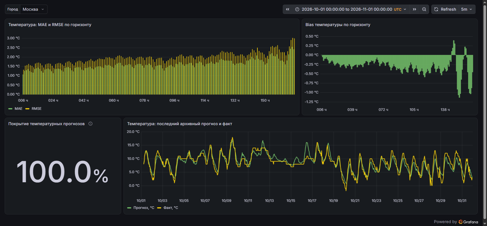
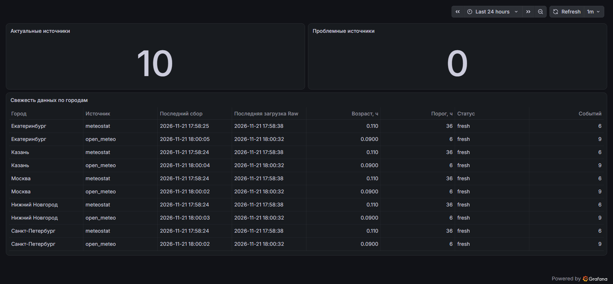

# Weather Forecast Analytics

Платформа собирает прогнозы Open-Meteo и сопоставляет их с почасовыми измерениями Meteostat. Она хранит оперативные снимки прогнозов и архивные выпуски ECMWF IFS, чтобы анализировать MAE, RMSE и Bias по горизонту и городу.

## Архитектура и стек

Python → Kafka → Spark Structured Streaming → PostgreSQL → dbt → Grafana. Apache Airflow запускает сбор и трансформации. Docker Compose поднимает локальный стенд. [Архитектурная схема и движение данных](docs/architecture.md)

## Быстрый запуск

В Linux или WSL с Docker Compose, Bash, Python 3 и curl скопируйте шаблон и заполните пустые секреты в `.env`.

```bash
cp .env.example .env
# Заполните локальный .env перед запуском.
./scripts/bootstrap.sh
./scripts/smoke-test.sh
```

[Airflow](http://127.0.0.1:8080) и [Grafana](http://127.0.0.1:3000) доступны локально. На чистом стенде включите сбор и трансформацию в Airflow. Запустите DAG `weather_forecast_collection` и `weather_observations_collection`, затем `weather_dwh_transform`. Для просмотра архивных сравнений выполните [историческую дозагрузку](docs/backfill.md).

## Хранилище и аналитика

Raw хранит события и Kafka offsets. dbt преобразует их через слои Staging и Intermediate в Core и аналитические витрины. Оперативный горизонт считается от часа сбора, архивный — от инициализации модели. Архивная витрина сравнивает горизонты от шести часов. Факты берутся из наблюдений Meteostat без модельного заполнения пропусков. [Методика сравнения](docs/data-model/marts.md)

Станция может находиться на расстоянии от точки прогноза. Время инициализации архивной модели предшествует публикации выпуска. Эти ограничения влияют на интерпретацию ошибок.

## Grafana

| Дашборд | Что показывает |
|---|---|
| Weather Forecast Quality | Точность оперативных прогнозов по городам и горизонтам |
| Historical Forecast Accuracy | Точность ECMWF IFS по горизонту и сравнение температуры с наблюдениями |
| Weather Pipeline Health | Последние сборы, свежесть данных и состояния источников |





## Структура

| Каталог | Содержимое |
|---|---|
| `ingestion/` | Клиенты источников, публикация в Kafka и CLI исторической загрузки |
| `airflow/`, `spark/` | Оркестрация и потоки в Raw |
| `database/`, `dbt/` | SQL-миграции, модели и проверки качества |
| `grafana/` | Источник данных и дашборды |
| `scripts/`, `docs/` | Запуск, сквозные проверки и документация |

## Документация

- [Локальное развёртывание и тома](docs/deployment.md)
- [Тестирование и восстановление](docs/testing.md)
- [Источники данных](docs/data-sources.md)
- [Историческая дозагрузка](docs/backfill.md)
